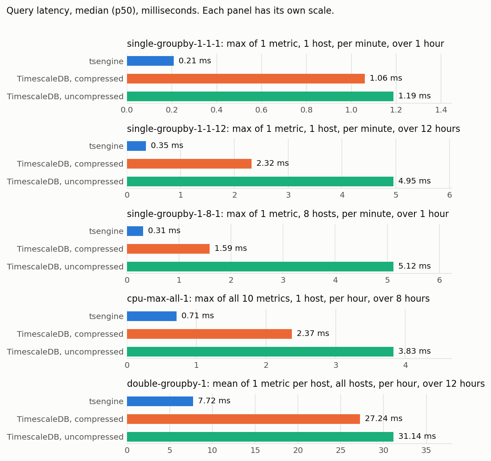
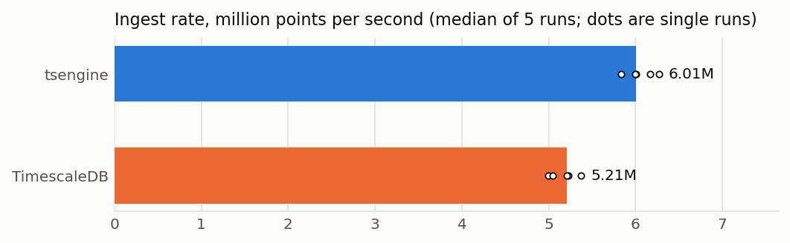
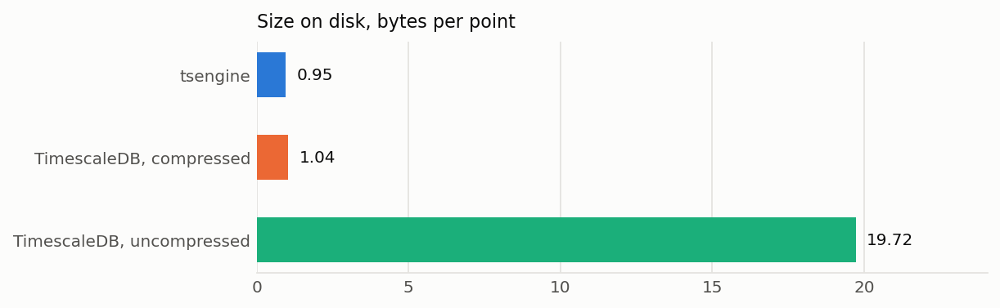
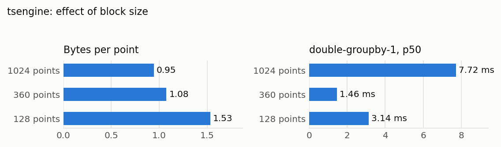
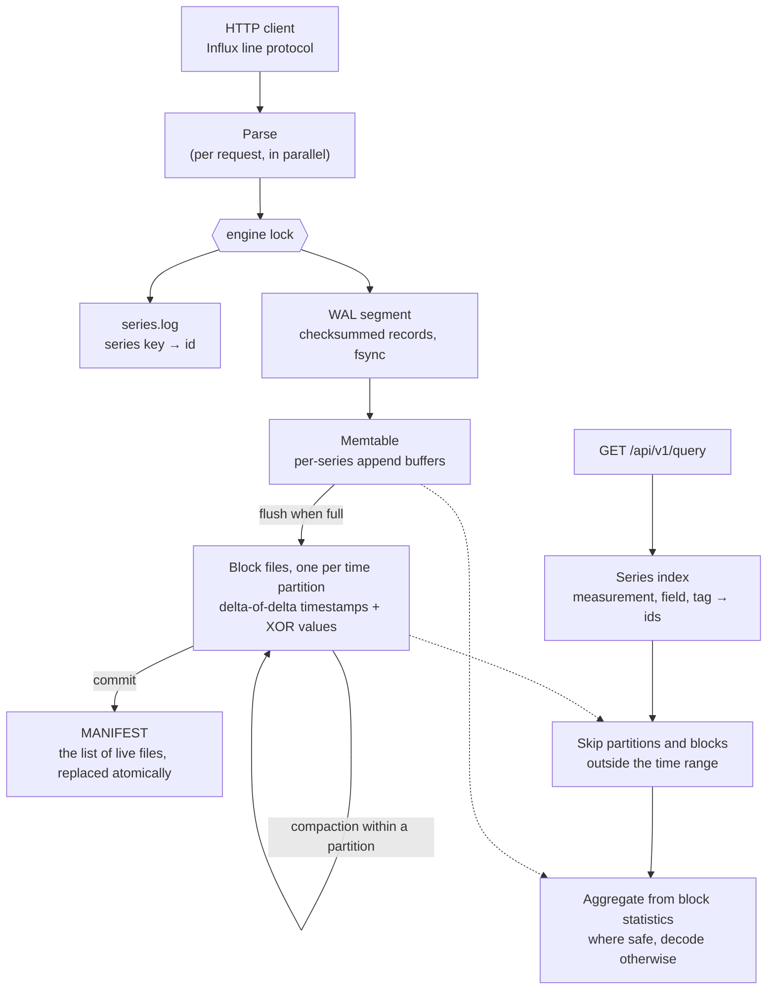

# tsengine

A time-series storage engine in C++20, built from scratch: write-ahead log, time-partitioned
columnar block files with Gorilla compression, compaction, crash recovery, and aggregate
queries with push-down, behind an HTTP API that accepts Influx line protocol. Benchmarked
against TimescaleDB on the [TSBS](https://github.com/timescale/tsbs) workload.

## Results

TSBS `cpu-only` dataset: 100 hosts reporting 10 metrics every 10 seconds for 3 days, which is
25.9 million points. Both systems ran on the same machine and were loaded by the stock TSBS
loaders. TimescaleDB 2.17.2 uses its native compression, segmented by series and ordered by time.

| | tsengine | TimescaleDB (compressed) | |
|---|---|---|---|
| Ingest, points per second | 6.01 M | 5.21 M | 1.15× faster |
| Size on disk, bytes per point | 0.945 | 1.040 | 9% smaller |
| `single-groupby-1-1-1`, p50 / p99 ms | 0.21 / 0.40 | 1.06 / 1.50 | 5.0× faster |
| `single-groupby-1-1-12`, p50 / p99 ms | 0.35 / 0.67 | 2.32 / 2.99 | 6.6× faster |
| `single-groupby-1-8-1`, p50 / p99 ms | 0.31 / 0.52 | 1.59 / 2.27 | 5.1× faster |
| `cpu-max-all-1`, p50 / p99 ms | 0.71 / 1.11 | 2.37 / 3.22 | 3.3× faster |
| `double-groupby-1`, p50 / p99 ms | 7.72 / 9.74 | 27.24 / 33.99 | 3.5× faster |

Every query was first checked to return the same answer on both systems: 10,000 comparisons
across the five query types and both TimescaleDB configurations, with no mismatches.

**Read these numbers with the following in mind:**

- **TimescaleDB is doing a harder job.** It is a full SQL database: it parses and plans every
  query, supports transactions, concurrent clients, joins, updates and arbitrary SQL. tsengine
  does one thing. A purpose-built engine being faster on its one thing is expected, not a
  verdict on TimescaleDB.
- **One client, warm cache, small data.** Queries ran one at a time, and 25.9 million points
  fit in memory. tsengine handles one request at a time behind a single lock, so under
  concurrent load its latency would grow where TimescaleDB's would not. That was not measured.
- **Five of the fifteen TSBS query types were run.** tsengine cannot express most of the rest:
  `lastpoint`, `high-cpu-*`, `groupby-orderby-limit`, and the variants that aggregate several
  metrics per host.
- **Where TimescaleDB is ahead in these measurements:** preparing loaded data for querying.
  Compressing its chunks took 4.3 s; tsengine's final compaction took 10.7 s.
- **WSL2 on a desktop PC,** not a server. Compare the two columns with each other, not with
  numbers measured elsewhere.

Uncompressed TimescaleDB was measured too: it uses 19.7 bytes per point and is slower than
compressed TimescaleDB on all five queries. Full tables, including every run, are in
[bench/results/REPORT.md](bench/results/REPORT.md), next to the raw result files.







### Aggregation push-down and block size

Each block of a file stores the count, sum, minimum and maximum of its values. An aggregate
query can answer from those instead of decoding the block, but only when the whole block falls
inside one time bucket. With the default 1024 points per block, a block of this data spans
2.8 hours, so none of the TSBS queries above benefit. Shrinking blocks to 360 points, exactly
one hour of this data, changes that:

| Points per block | Bytes per point | `double-groupby-1` p50 | Blocks answered from statistics |
|---|---|---|---|
| 1024 (default) | 0.945 | 7.72 ms | 0% |
| 360 | 1.076 | 1.46 ms | 85% |
| 128 | 1.533 | 3.14 ms | 64% |

So 14% more disk buys a 5.3× faster hourly aggregate, and going smaller than the bucket makes
both worse. The 360-point result depends on blocks lining up with hour boundaries, which they
do here only because the data is perfectly regular and each partition starts at midnight. It
shows what push-down can do; it is not a setting to rely on. Queries with one-minute buckets
are unaffected at every size.



### Method

- **Workload:** TSBS `cpu-only`, seed 123, scale 100, 2016-01-01 to 2016-01-04, 10 s interval.
  The same generated data for both systems.
- **Ingest:** `tsbs_load_influx` and `tsbs_load_timescaledb`, 4 workers, batches of 10,000 rows,
  into an empty database. Median of 5 runs; the range was 5.84–6.27 M points/s for tsengine and
  5.00–5.37 M for TimescaleDB. tsengine fsyncs its WAL on every request. TimescaleDB ran with
  the defaults of its Docker image, tuned by `timescaledb-tune` (`shared_buffers` 3892 MB).
- **Storage:** everything each system keeps on disk for the data, after tsengine has flushed
  and compacted and after TimescaleDB has compressed every chunk.
- **Queries:** 1,000 queries per type with random hosts and time windows from a fixed seed, sent
  to both systems by [bench/queryrunner](bench/queryrunner/main.go) using the SQL that TSBS
  generates. One untimed pass to warm up, then five timed passes: 5,000 samples per system and
  type. Timing covers the request and reading the full response.
- **Checking the harness:** the official `tsbs_run_queries_timescaledb` measured a median of
  1.47 ms for `single-groupby-1-1-1` and 27.26 ms for `double-groupby-1` on the same table. This
  harness measured 1.06 ms and 27.24 ms, so it is not making TimescaleDB look slower than TSBS
  does.
- **One change to TSBS:** its TimescaleDB loader passes an argument that TimescaleDB 2.14
  removed. [bench/setup.sh](bench/setup.sh) replaces it with a no-op so that the baseline can be
  a current release.
- **Machine:** AMD Ryzen 7 7800X3D (8 cores, 16 threads), 15 GB RAM available to WSL2, ext4,
  Ubuntu 24.04, GCC 13.3 `-O3` (CMake Release), Docker 29.1.

## Architecture



A write is acknowledged once it is in the write-ahead log. Points collect in the memtable and
are flushed into immutable, compressed block files, one per day of data. Replacing the manifest
is what commits a flush or a compaction, so a crash at any moment leaves either the old set of
files or the new one. The full design, with file formats, is in
[docs/design.md](docs/design.md).

## Build, test, run

Linux (or WSL2), CMake ≥ 3.25, Ninja, GCC ≥ 12 or Clang ≥ 15.

```bash
cmake --preset debug          # Debug + ASan/UBSan
cmake --build --preset debug
ctest --preset debug          # 139 tests
```

```bash
cmake --preset release && cmake --build --preset release
build/release/tsengine_server --dir ./data --port 8086
```

Write points as Influx line protocol, then query them:

```bash
curl -X POST 'http://127.0.0.1:8086/write' --data-binary \
  'cpu,host=a usage=58 1451606400000000000
cpu,host=a usage=61 1451606410000000000
cpu,host=b usage=12 1451606400000000000'

# Raw points of one series
curl 'http://127.0.0.1:8086/api/v1/query?measurement=cpu&field=usage&tag=host:a'

# Maximum per minute across all hosts, and mean per host over everything
curl 'http://127.0.0.1:8086/api/v1/query?measurement=cpu&agg=max&bucket=60000000000'
curl 'http://127.0.0.1:8086/api/v1/query?measurement=cpu&agg=mean&group_by=host'
```

### Reproduce the benchmark

Needs Docker, Go, `jq` and Python with matplotlib. About 25 minutes.

```bash
bench/build.sh release    # builds into ~/tsbench
bench/setup.sh            # builds TSBS, pulls TimescaleDB, generates the dataset
bench/run_all.sh          # loads, measures, cross-checks; results in ~/tsbench/results
python3 bench/report.py ~/tsbench/results docs/img
```

## How it is tested

- **Unit and property tests** for every component. The encoders, WAL, block files, engine and
  aggregation are each checked against a simple in-memory model over thousands of random
  operations, including restarts.
- **Crash tests.** A writer process is killed with `SIGKILL` at random moments, and separately
  made to exit at each step of a write, a flush and a compaction. After every kill the database
  is reopened and must hold every acknowledged batch, nothing else, and no stray files.
- **Sanitizers.** CI runs everything under AddressSanitizer and UndefinedBehaviorSanitizer, on
  GCC and Clang.
- **TSBS in CI.** Every push loads TSBS data with the stock loader and verifies the counts,
  before and after a kill.

## Design decisions

| Decision | Why | Cost |
|---|---|---|
| Write-ahead log; a batch is one checksummed record | A write survives a crash once acknowledged, and a batch is recovered whole or not at all | Every write is written twice |
| Manifest replaced atomically | One rename commits a flush or compaction; no half-finished state to repair | Rewritten whole on every change |
| One block file per time partition | Retention deletes files, queries skip partitions, late data never rewrites recent files | Many small files when data arrives very late |
| Delta-of-delta and XOR encoding (Gorilla) | Regular timestamps cost about one bit; slowly changing values a few | Poor on irregular timestamps and noisy floats |
| Statistics per block in the file index | Blocks can be skipped or summarised without being read | Only helps when a block fits inside one bucket |
| Size-ratio compaction inside a partition | Small files merge often, large files rarely | Several files per partition to read at once |
| Single-threaded engine behind one lock | Simple enough to prove crash-safe | No concurrent queries |

## Limitations

- **One request at a time.** The engine is single-threaded. Requests are parsed in parallel, but
  storing and querying take turns, and a flush or compaction blocks both.
- **No query language.** One aggregate per request over one measurement; no joins, expressions,
  value filters or "latest point" queries.
- **Float values only,** one per series. Strings and booleans are rejected, and integers above
  2^53 lose precision.
- **Push-down is narrow.** It needs a whole block inside one bucket, and nothing overlapping it
  in a newer file or in memory. There are no rollups.
- **The series index lives in memory** and is rebuilt on startup, so startup time and memory
  grow with the number of series. Not suited to millions of series.
- **Crash safety is tested against process death, not power loss.** The fsync ordering is
  designed for power loss, but nothing here tests it.
- **Retention removes whole partitions** of flushed data only.
- **Linux only.** No authentication, no TLS.
- **Compression figures are for this dataset.** TSBS CPU metrics are small integers that change
  slowly, which is close to the best case for these encoders. The Gorilla paper reports 1.37
  bytes per point on Facebook's production data; 0.945 here does not mean this beats it.
